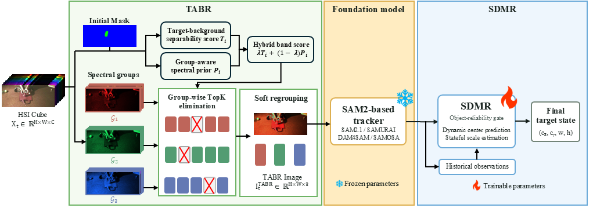
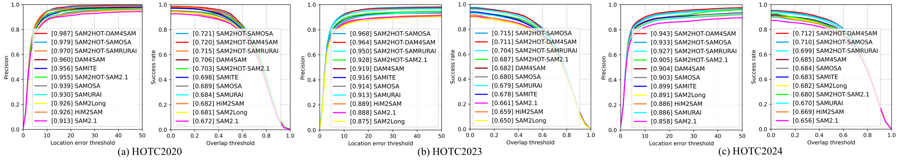

# Target-aware spectral regrouping and decoupled motion recovery for SAM2-based hyperspectral object tracking. 


## Abstract

Hyperspectral imagery provides richer spectral signatures for distinguishing visually similar targets, yet the scarcity of large-scale hyperspectral tracking datasets motivates adapting RGB-pretrained foundation models such as Segment Anything Model 2 (SAM2). However, directly applying SAM2-based trackers to hyperspectral videos presents two key challenges: conventional three-channel conversion can discard target-discriminative spectral information, while occlusion or segmentation failure can produce unreliable masks that destabilize target-state estimation. To address these issues, we propose SAM2HOT, a plug-and-play framework that enhances SAM2-based tracking through spectral adaptation and motion-aware state recovery. Specifically, Target-aware band regrouping  exploits the initial target region to identify informative spectral bands and adaptively regroup them into a target-discriminative three-channel representation compatible with SAM2. To improve temporal robustness, SAM2-aligned decoupled motion recovery separately models target center and scale, whose temporal dynamics exhibit different characteristics, and recovers reliable target states when SAM2 observations become unreliable. This decoupled formulation preserves temporal continuity without imposing a unified motion model on bounding-box parameters. 
SAM2HOT requires no fine-tuning of the SAM2 backbone and can be readily integrated with existing SAM2-based trackers. Experiments on HOTC2020, HOTC2023, and HOTC2024 demonstrate consistent improvements over baseline SAM2-based trackers in tracking accuracy while maintaining real-time efficiency and robustness.

## Overview



## Results



## Requirements

```bash
conda create -n sam2hot python=3.11 -y
conda activate sam2hot
python -m pip install torch==2.3.1 torchvision==0.18.1 --index-url https://download.pytorch.org/whl/cu121
python -m pip install -r requirements.txt
```

## Pretrained Models

Download the [SAM2.1 Hiera Large checkpoint](https://dl.fbaipublicfiles.com/segment_anything_2/092824/sam2.1_hiera_large.pt)
and place it at `weights/sam2.1_hiera_large.pt`.
The motion checkpoint is already included at `weights/motion_image_norm_l5_o3.pth`;
no additional download is needed.

## Data Preparation

Prepare HOTC2020 with the original HSI mosaics, false-color images and annotations:

```text
HOTC2020/test/
  SEQUENCE/
    HSI/                 # Frame images and groundtruth_rect.txt
    HSI-FalseColor/      # Corresponding false-color frames
```

Set the dataset and checkpoint paths in [configs/hot20.yaml](configs/hot20.yaml).
All training and testing defaults are provided in this file.

## Training

First run frozen DAM4SAM on the HOTC2023 training partition (VIS, NIR and RedNIR)
and save its raw trajectories as `<modality>-score-<sequence>.txt`, with one row
per frame: `x y width height selected_sam_pred_iou`. Pair them with the original
annotations and aligned false-color frames; retain any `.meta.json` files.
These are raw observations, not SDMR-corrected predictions.

Set `training.data_root` and `training.score_root` in the config, then run:

```bash
python train_motion.py --config configs/hot20.yaml
```

The best checkpoint is saved to `checkpoints/motion_l5_o3/best.pth`; set
`motion_checkpoint` in the config to this path to evaluate a newly trained model.

## Testing

Test HOTC2020:

```bash
python run_hot20.py --data-root /path/to/HOTC2020/test --output-root outputs/hot20
```

Test a single sequence using the configured dataset path:

```bash
python run_hot20.py --sequence ball --output-root outputs/ball
```

Each run regenerates TABR inputs and runs DAM4SAM + SDMR. Final boxes are saved
under `predictions/` and AUC/DP20 in `summary.json`. Use a new output directory
for each run.

## Acknowledgments

We thank [SENTRY (ECCV 2026)](https://github.com/HamadYA/SENTRY),
[DAM4SAM](https://github.com/jovanavidenovic/DAM4SAM), and
[SAM2](https://github.com/facebookresearch/sam2) for their open-source implementations.
